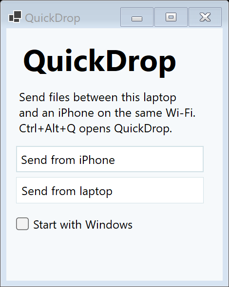
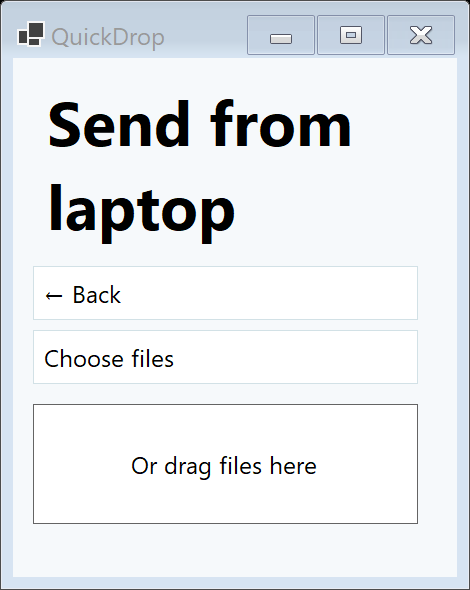

# QuickDrop

A small Windows tray app for moving photos, videos and documents between a laptop and an iPhone on the same Wi-Fi. The iPhone needs only Camera and Safari. QuickDrop has no Electron, Node.js, account, cloud transfer, or .NET installation requirement for users.

## Install once

1. [Download QuickDrop-Setup.exe](https://github.com/Renanlvrt/QuickDrop/releases/latest/download/QuickDrop-Setup.exe) and run it. The installer puts QuickDrop in your user account and opens it. It does not need administrator rights.
2. In QuickDrop, check **Start with Windows** if you want the hotkey always available.
3. Press **Ctrl+Alt+Q** or double-click the tray icon. Choose **Send from iPhone** or **Send from laptop** and scan the QR with the iPhone Camera.





For phone uploads, choose the default `Documents/QuickDrop/sentFiles` folder, the previous folder or a new folder before the QR appears. For laptop-to-phone transfers, choose files or drag them into QuickDrop. Scanning the QR requests one original file directly, or one ZIP if several were selected. iOS Safari may show its own download confirmation.

The app remains in the tray when its window closes. Right-click the tray icon and choose **Exit** to stop it.

## Security and limits

- A transfer server runs **only after you create a QR**, binds to one private LAN address, and closes after ten minutes or when you start another transfer or exit.
- Every QR contains a random 192-bit secret. Unknown URLs cannot upload or download. For phone uploads, the QR page must open first; that phone's network address is then the only one allowed to upload in that session.
- Only the chosen destination accepts uploads. Names are sanitized, existing files are never overwritten, and one session accepts at most 10 GB of uploaded data. Laptop downloads can read only files explicitly selected for that session.
- Transfers use HTTP on the local network. Use trusted Wi-Fi; this is **not end-to-end encrypted** and cannot protect a QR link from someone who sees or copies it. A QR scan cannot be distinguished from opening a copied link. No local network tool can promise zero risk from malicious devices.
- The first run may trigger a Windows Firewall prompt. Allow QuickDrop only on a **private** network you trust, never on public networks.
- The Windows installer is currently unsigned, so Windows may identify its publisher as unknown. Do not run a copy from an untrusted source. The source and release build are public in this repository.

## Test on another machine

Install the release on a second Windows laptop, connect it and an iPhone to the same trusted Wi-Fi, and try both QR directions. A VM can test the installer and interface; for a real phone-to-VM transfer its network adapter must be reachable from the iPhone, which typical NAT mode may prevent. This app is independent of QuickPlan and uses a different hotkey.

## Build from source

Developers need the .NET 9 SDK. Users do not.

```powershell
dotnet run --project native-tests/QuickDrop.Tests.csproj -c Release
dotnet publish native/QuickDrop.csproj -c Release -r win-x64 --self-contained true -p:PublishSingleFile=true -p:IncludeNativeLibrariesForSelfExtract=true -p:DebugType=none -o release
```

The GitHub Actions workflow builds the same executable and packages it with Inno Setup when a `v*` tag is pushed. The released installer and its SHA-256 hash are attached to the release.
